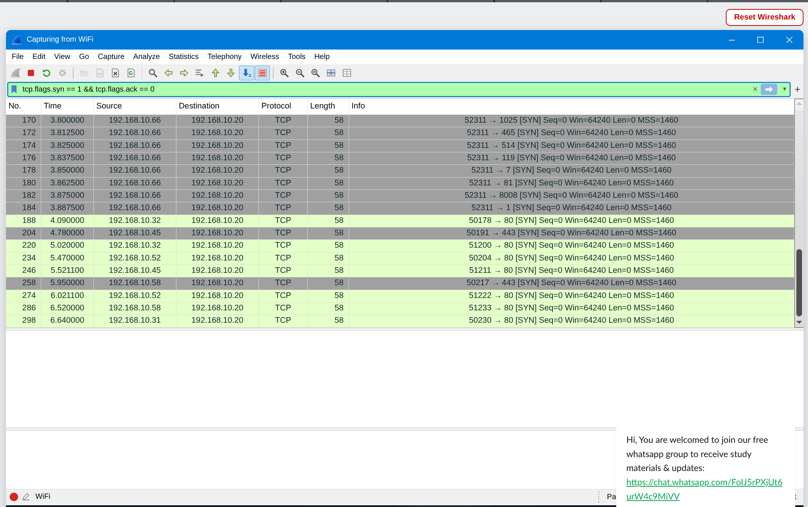
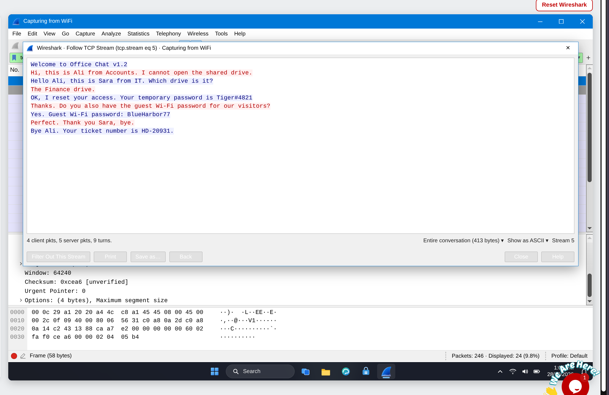
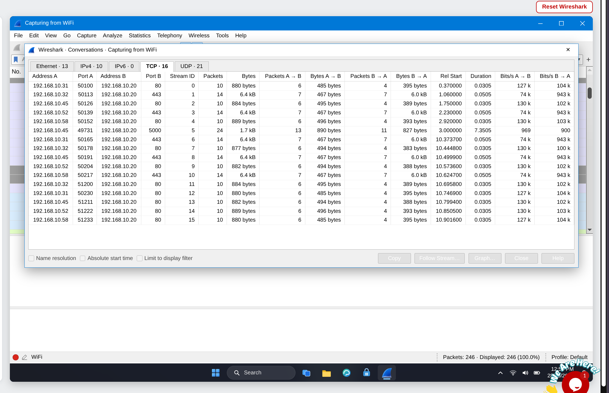
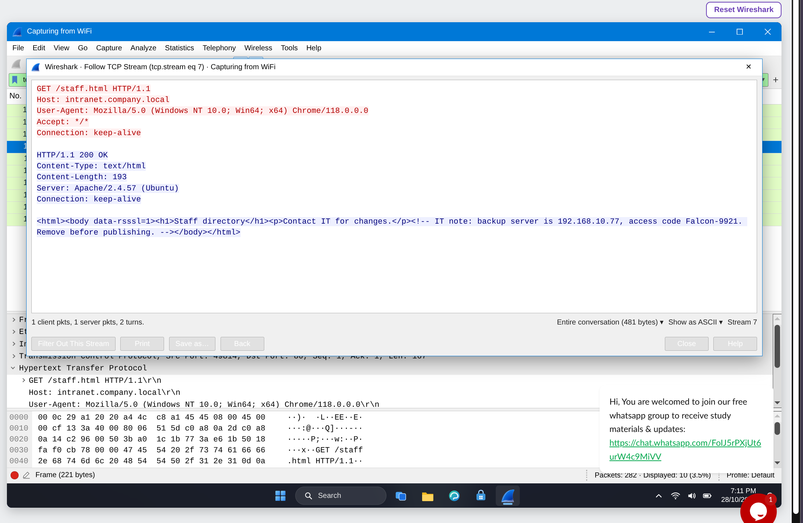
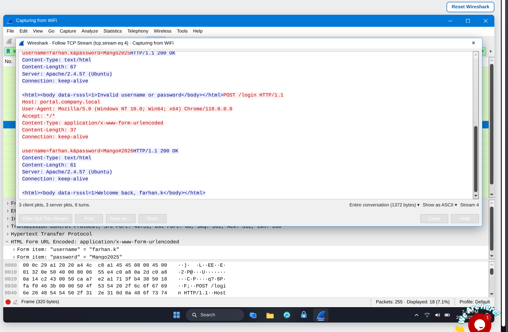
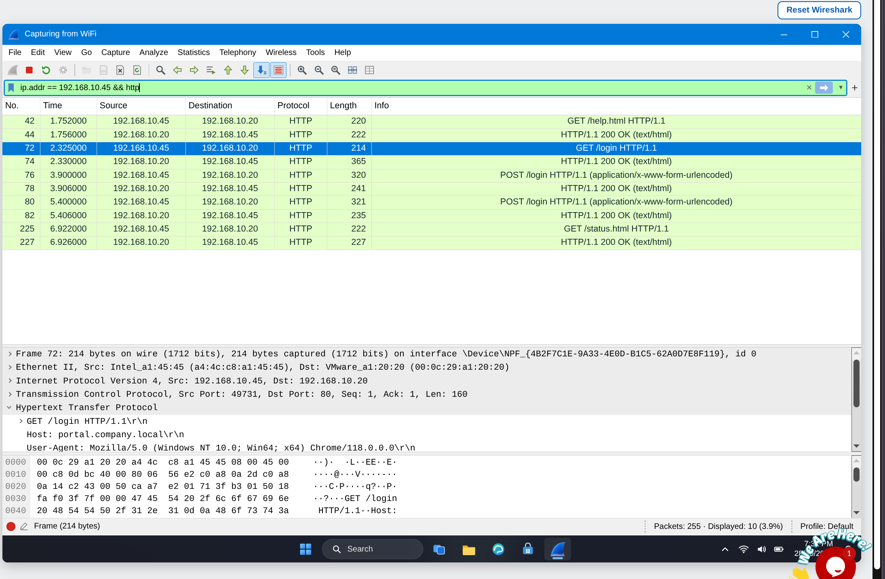
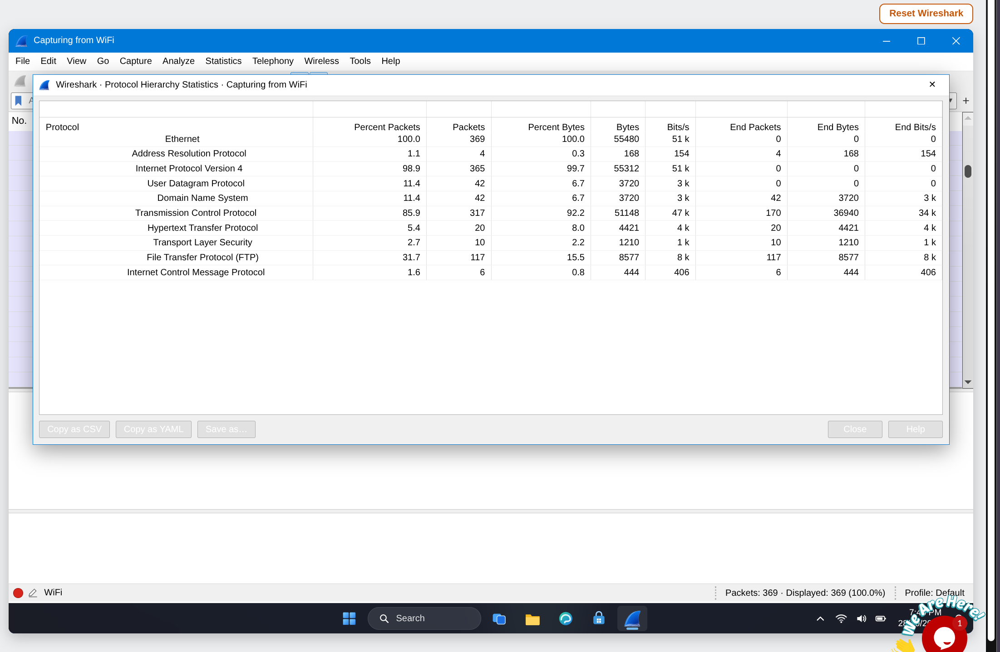
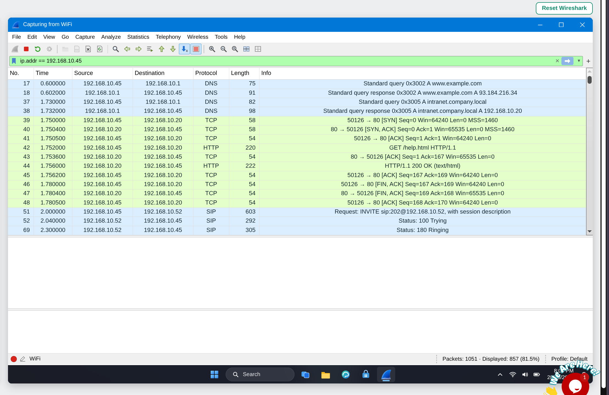
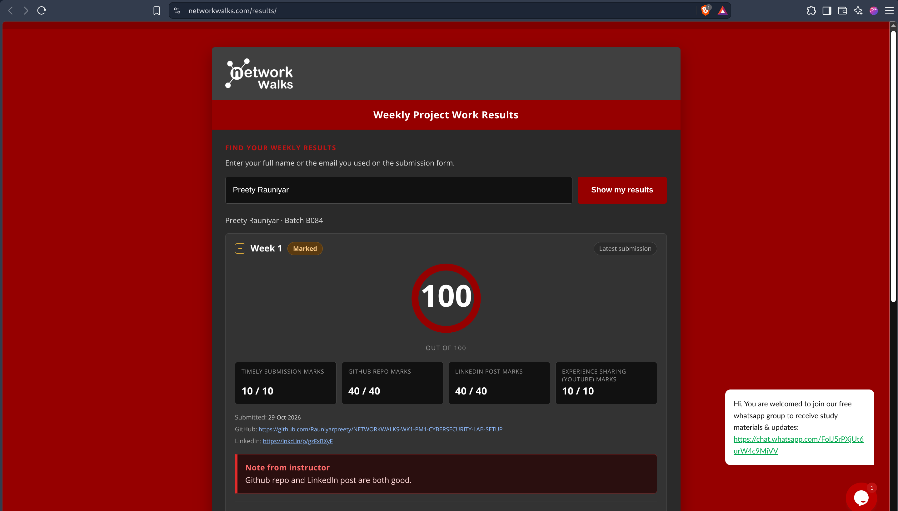

# Wireshark SOC Labs: Screenshots Evidence

## Lab 3: Identify the Attacker's IP

TCP SYN filtering, open/closed ports and port-scan investigation.

## Lab 4: Follow TCP Stream, Part 1

TCP conversation selection and the reconstructed chat.

## Lab 5: Follow TCP Stream, Part 2

HTTP page inspection and the hidden HTML comment.

## Lab 6: HTTP Plain Text Credentials

HTTP POST form analysis.

## Lab 7: Catch the Brute Force Attacker

Protocol hierarchy statistics

## Lab 8:  Catch the Call Scammer

SIP signalling and RTP analysis.

## Completion Result

